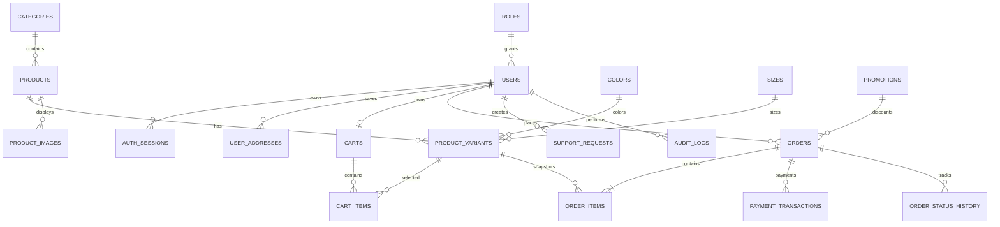

# Database SQL Server cho BẢN SẮC Ecommerce

## Thứ tự chạy trong SSMS

1. Mở SQL Server Management Studio và kết nối SQL Server.
2. Chạy [01_schema.sql](01_schema.sql).
3. Chạy [02_seed.sql](02_seed.sql).
4. Chạy [03_procedures.sql](03_procedures.sql).
5. Refresh Databases → `bansacdb` → `Tables`.

## Nhóm bảng

- Xác thực và phân quyền: `Roles`, `Users`, `AuthSessions`, `PasswordResetTokens`.
- Địa chỉ: `UserAddresses`.
- Catalog: `Categories`, `Products`, `Colors`, `Sizes`, `ProductVariants`, `ProductImages`.
- Giỏ hàng: `Carts`, `CartItems`.
- Khuyến mãi: `Promotions`, `PromotionUsages`.
- Đơn hàng: `Orders`, `OrderItems`, `OrderStatusHistory`.
- Thanh toán: `PaymentTransactions`.
- CSKH: `SupportRequests`, `NewsletterSubscribers`.
- Theo dõi quản trị: `AuditLogs`.

## Phân quyền nghiệp vụ

| Role | Quyền chính |
|---|---|
| `customer` | Profile, địa chỉ, giỏ và đơn của chính mình |
| `support` | Xem đơn, xử lý yêu cầu khách hàng |
| `warehouse` | Xem biến thể, cập nhật tồn kho và giao hàng |
| `manager` | Quản lý catalog, khuyến mãi và đơn hàng |
| `admin` | Toàn quyền, phân quyền và audit |

Quyền API vẫn phải được kiểm tra ở backend. Role trong database không thay thế authorization middleware.

## Nguyên tắc quan trọng

- `Users.PasswordHash` chỉ chứa chuỗi hash `scrypt`; không lưu mật khẩu thuần.
- `AuthSessions.TokenHash` chỉ chứa SHA-256 của session token.
- `OrderItems` lưu snapshot tên, SKU, giá, size và màu để đơn cũ không đổi khi catalog bị sửa.
- `PaymentTransactions` không bao giờ lưu số thẻ hoặc CVV.
- Tiền dùng `DECIMAL(19,2)`, không dùng `FLOAT`.
- Thời gian lưu UTC bằng `DATETIME2` và `SYSUTCDATETIME()`.
- Tồn kho nằm ở `ProductVariants`, không nằm trực tiếp tại `Products`.
- Tạo đơn và trừ/giữ tồn kho cần chạy trong cùng transaction.

## Chuỗi kết nối mẫu

SQL Authentication:

```env
DB_PROVIDER=mssql
DB_SERVER=localhost
DB_PORT=1433
DB_NAME=bansacdb
DB_USER=sa
DB_PASSWORD=your-strong-password
DB_ENCRYPT=false
DB_TRUST_SERVER_CERTIFICATE=true
```

Windows Authentication thường dùng `msnodesqlv8`; với Docker hoặc môi trường triển khai nên dùng SQL Authentication và secret manager.

## ERD rút gọn



## Backend SQL Server

Backend SQL Server nằm tại `server/sql-app.js`, connection pool tại
`server/sqlserver.js`. Chọn provider bằng `DB_PROVIDER=mssql`. Các truy vấn nhận
dữ liệu từ người dùng đều sử dụng parameter và luồng tạo đơn dùng transaction để
cập nhật tồn kho cùng đơn hàng. Nên chạy `usp_CleanupExpiredAuthData` định kỳ bằng
SQL Server Agent khi triển khai lâu dài.
